<!--
  GitHub profile README for Rahulsaini81  (self-hosted animated SVGs in the assets/ folder)
  UPLOAD: put README.md and the whole assets/ folder in the repo "Rahulsaini81" (branch main).
  REPLACE: YOUR-LINKEDIN-USERNAME (appears twice) with your real LinkedIn username.
-->

  

  

  
  
  
  

 

Hi, I'm **Rahul Saini**, a WordPress & Shopify Developer from Ambala, Haryana. I turn Figma designs into **fast, responsive, SEO-friendly websites** and build custom themes, plugins and eCommerce stores that clients can manage on their own.

I have **3+ years of hands-on experience** and have delivered **50+ live websites** for clients in pharma, aviation, manufacturing, retail and services. I'm open to **WordPress, Shopify and Frontend roles**, and remote opportunities are welcome.

 

 

 

**Frontend** 

**CMS, eCommerce & Backend** 

**Design & Tools** 

 

 

 

 

 

 

<b>Also built:</b> Professional Plumbing, Career Booster, Alumex International, Squad Industrial Training, Peak Performance, Pink Holiday, Teach House, Buyprint, Being Mom and more.

 

🎓 B.A., Kurukshetra University &nbsp;·&nbsp; Certificate in Web Designing & Multimedia, Hartron Skill Centre

 

 

Have a WordPress or Shopify project, or a role where I can help? I'd love to hear from you.

  
  
  

  

